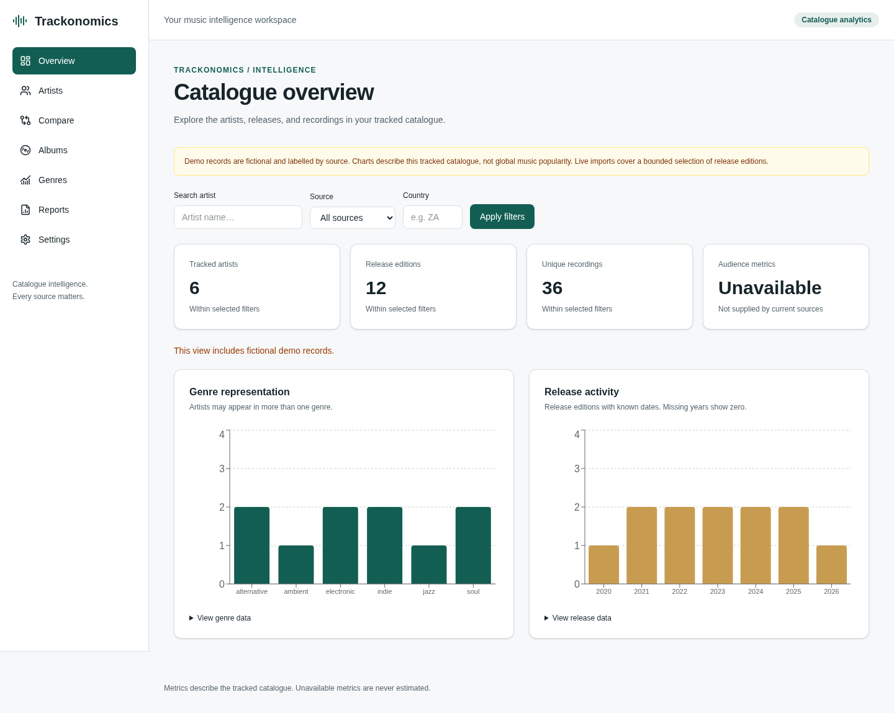

# Trackonomics

A music catalogue analytics platform built with Next.js, FastAPI and PostgreSQL. The workspace defaults to real Spotify metadata imported through your Developer app, with attributed artist profiles, catalogue comparisons and filtered reports.

> No sample data is loaded automatically. Spotify credentials are configured only on the API server. Charts describe imported catalogue entries, not global music popularity; unavailable metrics are never invented.



The screenshot uses explicitly labelled fictional test fixtures. Normal deployments default to Spotify.

## What works

- Responsive overview with artist/release/recording counts and interactive Recharts visualizations.
- Paginated artist search and source/country/name filters; artist profiles and discographies.
- Comparison of two to five artists with explicit unavailable-metric states.
- Album edition lists, partial source dates, genre representation and release-year trends.
- Filtered CSV/PDF reports with source attribution, report limits and formula-safe CSV fields.
- Spotify Client Credentials integration with bounded album/track imports, source links, token refresh and actual metric availability snapshots.
- Bounded, operator-authorized MusicBrainz ingestion with paced requests, retries, transactional upserts and run auditing.
- PostgreSQL migrations, test suites, security controls, CI and Vercel/Render configuration.

Spotify integration is implemented; connecting it requires your Developer app credentials and permitted API access. Follow the [Spotify connection guide](docs/spotify.md). No user accounts or tenant-private data access are implemented.

## Local development

Requires Node 24 (see `frontend/.nvmrc`), Python 3.12+, uv (tested with 0.12.23), Docker Engine and Compose v2. Use the existing checkout; cloud tasks are already isolated and do not need a worktree.

From the repository root, copy templates **only if those local files do not exist**:

```sh
cp -n .env.example .env
cp -n backend/.env.example backend/.env
cp -n frontend/.env.example frontend/.env.local
docker compose up -d --wait db
cd backend
uv sync --locked
uv run alembic upgrade head
uv run uvicorn app.main:app --reload --host 0.0.0.0 --port 8000
```

In another terminal, from the repository root:

```sh
cd frontend
npm ci
npm run dev
```

The frontend uses port 3000; API docs are on port 8000 at `/docs`. Open `/dashboard` in the frontend. `GET /health` must return HTTP 200 and `{"status":"ok","database":"connected"}`. `python scripts/smoke.py` validates readiness, workspace routes and the frontend API proxy.

The root `.env` configures Compose. `backend/.env` configures FastAPI. `frontend/.env.local` configures the server-side upstream. Keep PostgreSQL credentials/port and `DATABASE_URL` in sync. Local credentials are development defaults; replace them before deployment. Never commit `.env` files. PostgreSQL initializes credentials only on a new data volume.

The workspace starts empty until real artists are imported. For isolated tests only, `uv run python -m app.seed` loads fictional records idempotently; these are excluded from normal Spotify reads. Stop the DB with `docker compose stop db`; `docker compose down` retains data, while `docker compose down -v` permanently deletes it.

## Checks

With PostgreSQL migrated, from `backend/`:

```sh
uv run pytest
uv run ruff check .
uv run ruff format --check .
uv run alembic check
```

From `frontend/`:

```sh
npm run lint
npm run typecheck
npm run format:check
npm test
npm run build
npm run test:e2e
```

The fixture browser suite requires an isolated demo seed, running API on port 8000, and a frontend built with `NEXT_PUBLIC_DEFAULT_PROVIDER=demo npm run build`. It starts that frontend on port 3100. Rebuild without the fixture variable for normal Spotify use. Install a browser with `npx playwright install --with-deps chromium` if needed; this cloud environment uses `/usr/bin/chromium`. Set `CHROMIUM_PATH` for another system binary. The checks assert the deterministic demo counts, so use a dedicated development/test database rather than a mixed real catalogue. Unit-only backend checks without PostgreSQL: `uv run pytest -m 'not integration'`.

For production-mode local startup use `npm start` after building the frontend, and `bash scripts/start-production.sh` from backend (migrates first). Stop only your own existing frontend/API processes before reusing their ports.

## API and ingestion

Read endpoints under `/api/v1`: dashboard overview; artist search, profile, albums and comparison; albums; genre/release analytics. `POST /api/v1/reports` accepts `format` (`csv` or `pdf`), `provider` (`spotify` by default, `live`, `all`, `demo`, `musicbrainz`), `q` (artist name), and `country`. OpenAPI documents all parameters.

Live ingestion is disabled by default. For Spotify, securely set `SPOTIFY_CLIENT_ID`, `SPOTIFY_CLIENT_SECRET`, `INGESTION_ENABLED=true` and `INGESTION_TOKEN` (32+ random characters) on the API host. Use `POST /api/v1/ingestion/spotify/artists` with a Bearer operator token and a Spotify artist link in `artist_id`. See [the complete setup guide](docs/spotify.md). For MusicBrainz, also configure an identifying `MUSICBRAINZ_USER_AGENT` with your contact/project URL. Call `POST /api/v1/ingestion/artists` with a Bearer token and `{"artist_mbid":"ARTIST-UUID"}`. Do not embed tokens in source files, public browser code or chat. Configure egress to `musicbrainz.org` if restricted. Imports are bounded to 20 official release editions by default (maximum 100), paced at least 1.05 seconds per request, globally serialized and limited to one new run per minute. Live external-provider access was not validated in this cloud instance; provider behavior is covered by deterministic mocked tests.

## Documentation and deployment

- [Connect real Spotify data step by step](docs/spotify.md)
- [Phase-by-phase implementation, files, commands and results](docs/phase-log.md)
- [Architecture and interview talking points](docs/architecture.md)
- [Security and performance boundaries](docs/security.md)
- [Vercel + Render deployment runbook](docs/deployment.md)

`render.yaml`, `frontend/vercel.json` and `.github/workflows/ci.yml` prepare deployment and validation. Review hosting plans and secure settings before using them. No deployment or GitHub Actions run is claimed until performed remotely.
