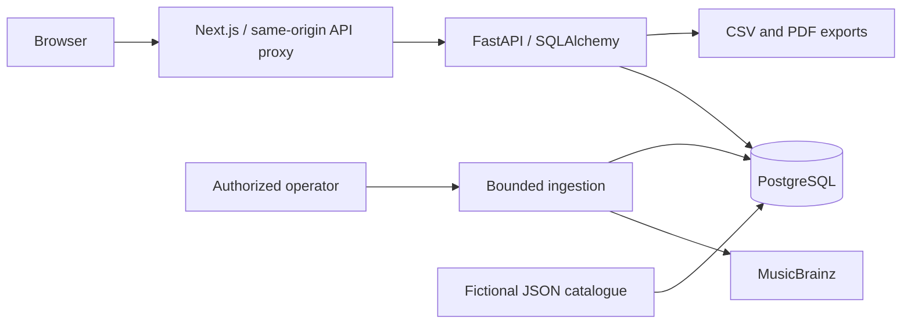

# Architecture and design decisions

`frontend/` contains Next.js App Router pages, a responsive workspace shell, shadcn/ui-compatible primitives, Recharts, typed API data and client loading/error/empty states. Browser requests use a same-origin rewrite configured by server-only `API_URL`. The UI never embeds ingestion credentials. Server-side data fetches are not required for builds, so the frontend builds while the API is offline.

`backend/` exposes versioned read APIs, filtered report generation and an explicitly enabled operator-only import API. Pydantic validates requests/settings; SQLAlchemy binds query parameters. SQL performs scope/filter/count/group operations before pandas/NumPy fill release-year gaps. Pagination and batch relationship loading bound queries; metric history uses a window function to select the latest snapshot per artist.

PostgreSQL is canonical. Ten domain tables separate artists, album editions, recordings, position associations, genres, provider identifiers, optional metric snapshots and ingestion audit runs. UUIDs are internal IDs, not provider IDs. Source mappings are polymorphic and maintained transactionally; their `entity_id` is not enforced by a single foreign key. Shared release editions/recordings are reusable. Partial dates remain strings with explicit year/month/day precision. Artist comparison track counts count release positions, while the overview counts distinct recordings. These are different denominators and are labelled accordingly.

MusicBrainz is the primary provider. Provider rate pacing includes retries, the import route is globally serialized with a PostgreSQL advisory lock, and run timestamps enforce a cooldown. Import scope is bounded official release editions, not complete discographies; tags are not authoritative global genres. Imports update mapped entities, and failures roll back catalogue changes while preserving a failed run record. The system does not automatically deduplicate equivalent real-world artists across different providers; `demo` is intentionally separate.

Demo fixtures contain six fictional artists, twelve release editions and thirty-six recordings. They supply no audience metrics. Null follower/popularity values stay null through API, comparison and exports. Actual metric snapshots, if supplied later by a supported provider, retain source and capture time. Spotify is optional and remains unimplemented; Trackonomics does not assume its restricted metrics exist.

Reports are generated in memory, carry source/filter/scope attribution, escape spreadsheet formulas and PDF markup, and have format-specific size caps. A second advisory lock bounds concurrent report generation. JSON bodies, hostnames and CORS are restricted; see security.md. This is a public catalogue MVP with operator ingestion, not a multi-tenant account system.

The deployment split is Vercel frontend + Render native Python service + managed PostgreSQL. Database migrations run before API startup. Hosting configuration is prepared but no live resources have been created. The GitHub CI workflow uses PostgreSQL and Chromium. See phase-log.md for phase-by-phase evidence and deployment.md for operational steps.
